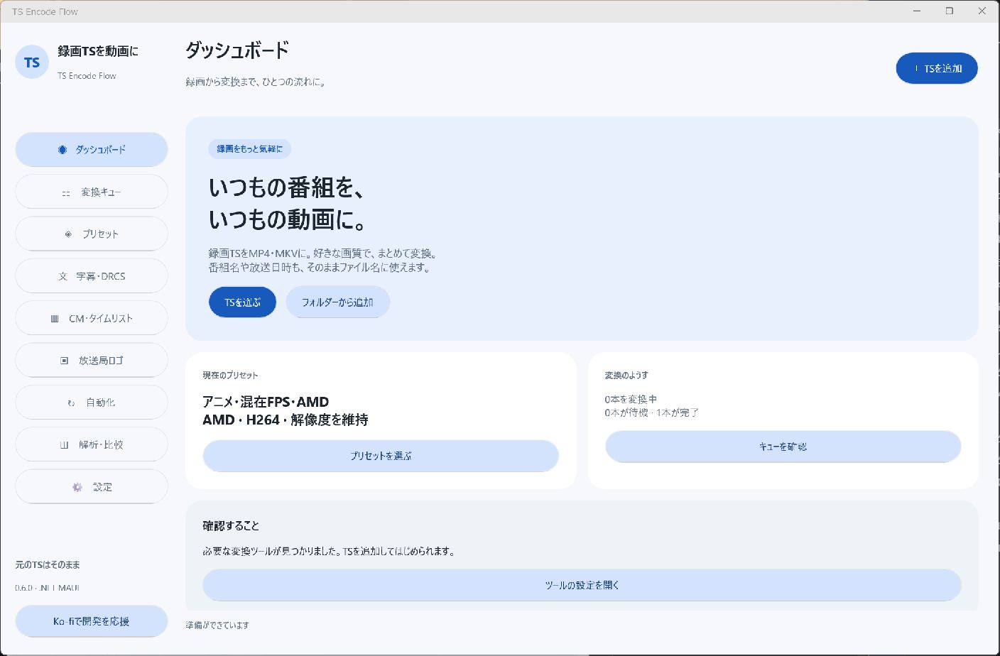
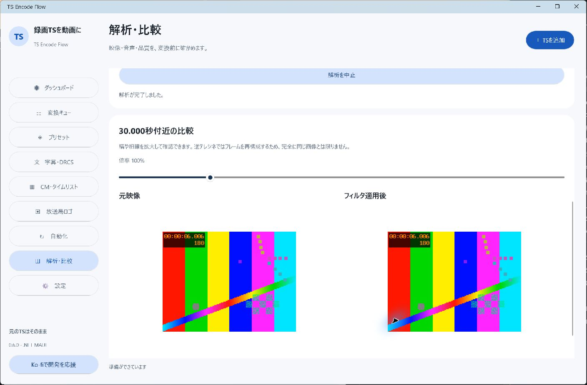
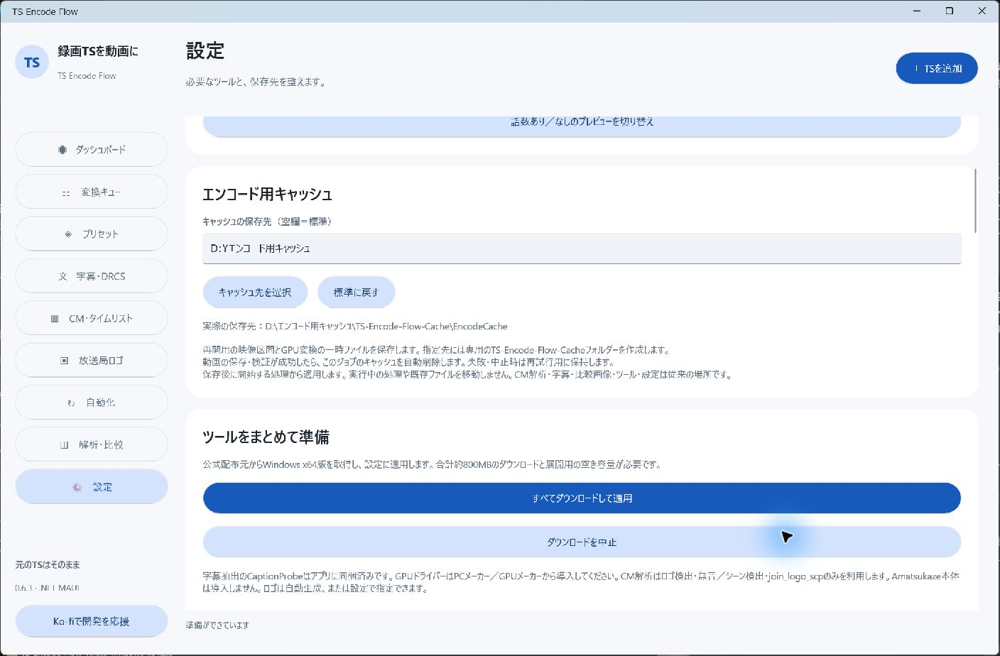

# TS Encode Flow

**録画TSを、いつもの動画へ。**

EDCB／EPGTimerなどで録画したTSを、MP4・MKVへ変換するWindowsアプリです。用途別プリセットで手動変換することも、録画終了後のBATから自動登録することもできます。元のTSは保持します。

[最新版をダウンロード](https://github.com/Long0823-1/TS-Encode-Flow/releases/latest) · [導入・操作手順](docs/SETUP.md) · [詳細変換・解析](docs/ADVANCED-ENCODING.md) · [検証範囲](docs/VALIDATION.md) · [Ko-fiで開発を支援](https://ko-fi.com/long0823)

長時間TSのCM解析では、全フレームの時刻を一時ファイルへ直接保存して読み込みます。以前の8MiBログ上限で途中までしか読めなかったキャッシュは再取得します。実際の録画データに時刻飛びがある場合は、箇所・最大の飛び・時刻差の合計を表示して自動CM適用を停止します。時刻欠落を詰めて残りを変換したい場合は、プリセットで下記の補正モードを明示的にONにできます。失われた映像を復元する処理ではありません。

## できること

| 用途 | 機能 |
| --- | --- |
| 録画を変換 | CPU／NVIDIA／AMD／Intel、H.264・HEVC・AV1、MP4・MKV |
| 用途から選ぶ | 通常番組・アニメ・映画・スポーツなど、12用途×4方式の48プリセット |
| 自分用に調整 | 解像度、クロップ、Yadif／Bwdif、品質、ビットレート、ノイズ除去、シャープ化 |
| 動きを整える | 3:2逆テレシネと低動作アニメの補助判定、区間別24/30/60fps・VFR |
| 変換前に確認 | 元映像と処理後の比較、拡大、品質・容量・速度・SSIMの試算 |
| 音声・字幕を残す | 複数音声、5.1ch、言語属性、字幕、DRCSの画像確認と代替文字登録 |
| CMを扱う | ロゴ・無音・シーン変化による解析、候補確認、チャプター・タイムリスト・カット |
| 局ロゴを管理 | 局・元解像度ごとの再利用、画像一覧、確認・削除、LGD／LGD2の手動追加 |
| 透過ロゴを消す | 登録済み局ロゴ（LGD）を使い、AviSynth＋DelogoHDでロゴ合成を逆算して除去 |
| 長い変換に備える | GPUへのパイプ送信、検証済み映像区間からの再開、破損キャッシュの再生成 |
| 状態を調べる | TSのCC欠落候補・受信エラー・時刻飛びをタイムラインで確認 |
| 自動化する | EPGTimer録画後BAT、フォルダー監視、最大8ジョブ、通知領域の常駐ワーカー |
| ファイルを整理 | 番組情報からの名前マクロ、番組メタデータ、同名出力の連番保存 |

対応コーデック・10bit・GPUフィルタは機器とドライバーに依存します。CPU／AMDで実変換を検証しています。NVIDIA／Intelの実機検証は未実施です。

## 最初の1本を変換する

1. [Releases](https://github.com/Long0823-1/TS-Encode-Flow/releases/latest)から **`windows-x64.zip`** を取得し、全ファイルを展開します。`Source code`は開発用です。
2. `TS-Encode-Flow.exe`を起動します。EXEだけを移動せず、`Worker`・`Tools`・DLLも一緒に残してください。
3. **設定 → すべてダウンロードして適用**でツールを準備し、動画の保存先とファイル名マクロを設定します。
4. **プリセット**で変換方式と用途を選びます。最初は「毎日の番組・バランス」などから試せます。
5. **＋ TSを追加**で録画済みTSを選び、**変換キュー**で進捗を確認します。

対応OSはWindows 10 バージョン2004以降／Windows 11のx64です。.NET／MAUI関連の実行ファイルは配布ZIPに含まれます。GPUには対応ドライバーが別途必要です。

FFmpeg・ffprobeはすべての方式で使います。各ツールは個別取得や手動パス指定もでき、画面から配布元・版・ハッシュ・ライセンス文書を確認できます。

## プリセットと解析・比較

既存設定の**詳細・カスタマイズ**、または**＋ 自作プリセットを追加**から作成できます。同名のカスタムは上書きし、不要なカスタムは削除できます。標準プリセットは保護します。

キューは処理中を最上部、開始待ちを実際の受付順で表示します。状態が変わった行もその位置へ移動します。**すべて中止**で処理中・開始待ち・確認待ちをまとめて中止し、新しい開始を一時停止できます。完成済みの履歴・元TS・完成動画・再開キャッシュは保持します。

ジョブは追加時の設定を保持します。登録後に変える場合は対象ジョブを中止し、**プリセットを変更 → 再試行**で個別に適用します。

**解析・比較**では、TSまたはキューのTSとプリセットを選びます。

- **比較プレビュー**：元映像とフィルタ適用後を左右に表示し、25～400%で拡大。
- **品質・容量・速度の試算**：品質値を最大6種類指定し、3区間の実変換でサイズ・速度・SSIMを比較。その品質でカスタムを保存。
- **混在FPSの全編解析**：区間ごとの23.976p／プログレッシブ維持／フィールド倍速を一覧で確認。
- **入力情報・音声一覧**：音声番号、言語、チャンネル数を確認し、プリセットの個別音声指定に利用。
- **TS診断**：CC欠落候補、TEI、同期ずれ、DTS飛びをタイムラインと一覧で確認。
- **ジョブの結果・再開情報**：処理した区間とキャッシュを確認し、不要なキャッシュを削除。

混在FPS、パイプ送信、複数音声、10bit・色域・レンジ・ディザ、TS診断、途中再開は、プリセットの**詳細映像・音声・再開**で選びます。[使い方と制約](docs/ADVANCED-ENCODING.md)を確認してください。

## CMと局ロゴ

**CM処理しない／残してチャプター・タイムリスト／カット**を選べます。自動解析はAmatsukazeで使われるCM解析用ツール群を利用します。Amatsukaze全体の移植ではなく、Comskipも使いません。

未登録局では元TSのプレビューでロゴ範囲を指定します。生成画像の確認待ちになった場合は、局ロゴだけが写っているか確認して登録します。**放送局ロゴ**から局・元解像度ごとの画像一覧、拡大、削除、手動LGD追加ができます。

自動ロゴ取得に失敗した場合だけ無音・シーン変化へ切り替えるには、プリセットの**ロゴ取得失敗時は無音・シーンチェンジのみで続行**を事前にONにします。「ロゴを使わない」は最初からロゴなしで解析する別設定です。

CM判定には誤検出があります。最初は候補確認をONにしてタイムリストを確かめてください。CMカットは音声コピーOFF・手動FPS指定なしで使います。詳細パイプラインでは選択した全音声も同じ区間で処理します。

### 透過ロゴを消す

プリセットの**透過ロゴを消す**をONにすると、登録済み局ロゴ（LGD）を使って変換前にロゴを取り除きます。周囲の画素から補間する方式ではなく、LGDに記録されたロゴ色と透明度から合成を逆算して背景を復元します。処理はAviSynth＋DelogoHDで行い、CM解析用に導入済みのAviSynth／L-SMASHを再利用します。

事前に、ツール設定で**ロゴ消し · DelogoHD**をダウンロードして適用してください。局ロゴが未登録の局では使えないので、先にロゴ管理で登録してください。

併用：CM処理（チャプター・カット）、FPS指定、詳細パイプライン、自動逆テレシネ、音声コピーと組み合わせられます。CMカット時は保持区間をAviSynth側で切り取り、音声は既存のCM音声再構成で合わせます。映像ストリームが複数あるTSでは、選択中の映像ストリームをL-SMASHインデックスへ対応付けて処理します。logoframeで検出したロゴの表示区間とフェードに追随して除去し、検出できない場合は全編へ一様に適用します。CMカット以外では音声コピーも使えます（CMカット時は従来どおり音声コピー不可）。可逆の中間映像を作ってから変換するため、空き容量と時間が余分に必要です。

## 録画の時刻欠落を詰めて変換する

プリセットの**詳細・カスタマイズ → 詳細映像・音声・再開 → 録画の時刻欠落を詰めて変換（補正モード）**をONにして保存します。初期値はOFFです。登録済みのジョブには、中止後に**プリセットを変更 → 再試行**で適用してください。

対象サービスを再エンコードせずにTSへコピーし、不連続な時刻を補正してからCM解析・逆テレシネ判定・映像音声変換・字幕抽出を行います。補正後の全フレーム時刻を検証し、重複・逆行・未解消の飛びがあれば停止します。CMインデックスとの違いは、補正モードに限り最大1フレーム・合計32フレーム以内まで許容し、ログに記録します。通常モードの照合は厳密なままです。

- **欠落した番組内容は復元できません。** 残っている部分をつなぐ救済用です。破損境界の映像乱れ・音ずれ・字幕ずれが残る場合があります。
- 補正後のCM・字幕は補正TS基準です。元TS基準の外部EDL／Trimは適用しません。自動解析または手動入力を使ってください。
- 元TS・番組名・録画日時は保持します。短縮前後の秒数をジョブ詳細・ログ・出力の`.encode.json`へ記録します。
- 補正TSは**エンコード用キャッシュ**の設定先へ保存します。対象サービスのTS一式に相当する空き容量と、全編読み取り時間が必要です。成功時は自動削除し、失敗・中止・確認待ちは再試行用に残します。
- 受信エラー・VFR・RFFなどをすべて修復する機能ではありません。補正できない入力は停止します。

## 字幕・DRCS・番組情報

字幕はMP4ではテキスト字幕、MKVではASSとして格納します。未対応のDRCSは**字幕・DRCS**で字形と参考画像を見比べ、代替文字を保存できます。

プリセットの**字幕の格納形式**では、MKV保存時にARIB字幕を変換せずそのまま格納することも選べます。「ARIBのまま」はMatroska規格の字幕コーデック `S_ARIBSUB` として生データを格納し、DRCS外字もそのまま残ります（DRCS確認も不要）。「変換＋ARIBの両方」は変換字幕（デフォルト）と生字幕の両方を入れます。生字幕の再生にはARIB字幕対応プレイヤー（mpv等）が必要です。MP4保存時は常に変換字幕になります。

**字幕エラーを無視して続行**をONにすると、未対応文字の置換や字幕なしでの続行を選べます。警告はログへ残します。

複数音声の自動選択では、チャンネル数・サンプルレートなどを取得できない空の音声ストリームを警告付きで除外します。TSの音声はPIDで対応付け、解析時と変換時で番号が変わる場合にも同じ音声を選択します。

番組情報はEDCBの`.program.txt`やTS内のEIT／SDTなどから取得します。マクロの例は`{Start:yyyyMMdd_HHmm}_{Channel}_{Title}`。取得できない項目にはファイル名・更新時刻などの代替値を使います。

条件分岐も使えます：`{if:Episode}{Title}_第{Episode}話{else}{Title}{endif}`。値の有無、文字列の一致・不一致、話数・解像度・IDの大小比較と8段までの入れ子に対応します。設定画面で話数あり／なしの出力例を確認できます。[書式と例](docs/FILENAME-MACROS.md)を参照してください。

## 本編の番組名を自動で選ぶ

録画前の余白を30秒などに固定して扱いません。EDCBの`.program.txt`が同じサービスの有効な番組名を持つ場合は、従来どおりその情報を優先します。

TSから取得する場合は、TDT/TOTの放送時計と選択サービスのPCRから録画先頭の放送時刻を推定します。EITの現在・次・番組一覧と録画中央付近の情報を集め、**録画範囲と重なる時間が最も長い番組**のタイトル・番組開始時刻・イベントID・説明をまとめて採用します。ファイル名マクロの`{Title}`・`{Episode}`や動画に保存する番組情報にも反映します。

放送時計や番組の開始・終了時刻が欠けて重複時間を判定できない場合は録画中央の番組へ、それも取得できなければ冒頭の番組へ戻ります。番組情報自体がなければファイル名を使います。判断理由をログと情報元に残します。ファイルの更新日時を放送時刻として扱って選別することはありません。

複数番組をまとめた録画や、本編より前後の別番組の方が長い録画では、意図した作品と一致しない場合があります。その場合はEDCBの`.program.txt`を併用してください。固定の「31秒地点」や、CM解析による映像内容の推測でタイトルを決める機能ではありません。元TSは変更せず、動画の先頭もカットしません。

## エンコード用キャッシュの保存先と自動削除

**設定 → エンコード用キャッシュ → キャッシュ先を選択**で保存先を指定すると、その場で保存します。**標準に戻す**も即保存します。手入力した場合は、同じ欄にある**キャッシュ設定を保存**を押してください。表示は未保存・保存済みを区別します。空欄なら従来の設定フォルダー内を使います。指定したフォルダーの中には専用の`TS-Encode-Flow-Cache/EncodeCache`を作成します。

画像はv0.6.3のものです。現行版では、この欄に「キャッシュ設定を保存」ボタンと保存状態の表示も追加しています。

対象は再開用の圧縮済み映像区間、GPU前処理の一時ファイル、補正モードのTSです。CM解析・字幕・比較画像・ロゴ・ツール・設定の保存先は変更しません。

完成動画の保存と検証が成功したら、そのジョブのエンコード用キャッシュを自動削除します。元TS・完成動画・ログ・ほかのジョブのキャッシュは保持します。失敗・中止した場合は再試行用に残し、再開設定がONなら検証済み区間を再利用します。

ロゴ消し用ランタイムの読み取り専用DLLも、アプリ専用の当該ジョブフォルダー内に限って属性を解除して削除します。読み取り専用DLLで削除が止まり、大きな中間映像が残る問題に対応しています。録画先とキャッシュ先が同じドライブの場合は、録画に必要な空き容量も確保してください。時刻補正・ロゴ消し・CM音声の準備前に空きを確認し、処理中に容量不足になった場合もAAC等の先行警告より容量不足を優先して表示します。

保存先の変更は次に開始する処理（再試行を含む）から適用します。実行中の処理や既存ファイルは移動しません。既に使った保存先をジョブごとに記録し、成功後や手動削除時にはそのジョブの過去のキャッシュも対象にします。削除できなかった場合は完成動画を保持して警告を表示します。外付けドライブを使う場合は接続したままにしてください。

## EPGTimerの録画終了後に自動変換する

1. **自動化**でBATに使う変換方式・プリセットを選びます。
2. **このプリセットで録画後BATを作成**から保存します。
3. 作成した`.bat`と`.bat.profile.json`を同じ場所に置きます。
4. EPGTimerの対象録画設定の**録画後実行**にBATを指定します。
5. まず1件の録画終了で、キュー登録と出力を確認してください。

`_EDCBX_DIRECT_`と`FilePath`環境変数での直接実行に対応したEDCB版が必要です。予約ごとに使っている録画設定へ反映されているかも確認してください。

BATは作成時のプリセット・保存先・マクロを保持します。後でGUIの設定を変えても作成済みBATには反映されません。設定やアプリの配置先を変えたら作り直します。

フォルダー監視が先に同じTSを登録していても、まだ開始していない監視ジョブには録画後BATの設定を優先して適用します。処理中・手動登録済みのジョブは変更しません。詳細ログの「適用プリセット（bat / watch / manual / job）」で実際に使用した全設定・出力先・マクロを確認できます。BAT用JSONが空・不正な場合は別のプリセットへ置き換えず、エラーを記録します。

## 常駐・待機・途中再開

GUIを閉じてもワーカーは通知領域で処理を続けます。ダブルクリックでキューを表示し、右クリックから確認画面や終了操作を選べます。PCのスリープ中・電源OFFでは処理は進みません。

追加時は自動開始しますが、既定でTSのサイズ・更新時刻が60秒間安定し、書き込み中でないことを確認します。以前から安定しているファイルは、追加後に必ず60秒待たせるわけではありません。

更新が止まり、書き込みプロセスも閉じたTSが0バイトの場合は、永久に終了待ちにせず録画データがないことを表示します。録画先の空き容量とEDCBの録画結果を確認してください。0バイトのTSから番組を復元することはできません。録画中で書き込みプロセスが開いているファイルは、この理由で失敗扱いにしません。

DRCS・CM・ロゴの確認待ちは操作が必要です。途中再開をONにしたジョブは、**再試行**で検証済み映像区間を再利用します。音声・字幕・最終結合は再実行します。入力・設定・ツール・実装が変わった場合は使い回しません。

**履歴をクリア**は表示上の完了・失敗・中止・中断を消します。元TS・完成動画・ログ・再開キャッシュは削除しません。失敗・中止などで残った不要なキャッシュは履歴を消す前に**解析・比較**から削除してください。

## 更新・制約

アプリ内でGitHubの正式リリースを確認し、新版があれば案内します。画面上部の**ダウンロードして更新**で、ダウンロード・SHA-256検証・差し替え・再起動まで完結します。実行中の変換が終わるまで待ち、更新中は新しいジョブを開始しません。設定・キュー・ロゴ・ダウンロード済みツールは保持し、ファイルの差し替えに失敗した場合は変更したファイルを復旧します。別の配置先で動くアプリやワーカーは終了させません。GitHubへの接続やSHA-256検証ができない場合は更新を適用せず、エラーを表示します。プレリリースは自動更新の対象外です。

CM解析は映像を元TSから直接読み取ります。無音検出には、検証済み映像の開始・長さに合わせた一時PCM音声を使い、破損AACのランダム読み出しで解析が停止する問題を避けます。映像の中間ファイルは作りません。一時PCMは解析終了・失敗・中止時に削除します。解析の最終フレームが確認できない場合はCM結果を自動適用しません。

途中で途切れたCMインデックスは再利用せず作り直します。補正モードでは、最大1フレームの時刻差が連続2フレーム以内で、前後で厳密な時刻一致へ戻る場合だけ境界差としてログへ記録します。通常モード、持続するずれ、大きな差、末尾の不一致は引き続き自動適用を停止します。

- 混在VFRは12秒単位の保守的な判定で、カット単位の精密なケイデンス復元ではありません。
- 比較は静止画です。SSIMは同じフィルタ適用後を基準にした圧縮の比較で、主観画質の優劣を保証しません。
- パイプ送信でも圧縮済み区間・結合用ファイルの空き容量は必要です。CPUフィルタがGPU処理に変わるわけではありません。
- 10bit・色域変換に対応しますが、HDR→SDRトーンマッピングは含みません。入力色が不明な場合は手動指定が必要です。
- 詳細パイプラインでは追加引数を空欄にし、専用項目で指定してください。
- TS診断は欠落候補を示すもので、元データの修復や正確な消失フレーム数の推定は行いません。

## 開発・ライセンス

[ビルド手順](docs/BUILD.md) · [詳細手順](docs/SETUP.md) · [検証記録](docs/VALIDATION.md) · [今後の機能案](docs/ADVANCED-IDEAS.md)

本体は[LICENSE](LICENSE)、外部ツール・ライブラリは[THIRD-PARTY-NOTICES.md](THIRD-PARTY-NOTICES.md)とアプリ内の表示を確認してください。CMロゴ補助ツールの対応ソースも配布します。

不具合報告にはアプリ・ツールの版、使用プリセット、工程、エラー部分のログが役立ちます。公開前に、ローカルパスや番組情報など公開したくない内容を確認してください。

開発・検証・保守への支援は[Ko-fi](https://ko-fi.com/long0823)から受け付けています。
