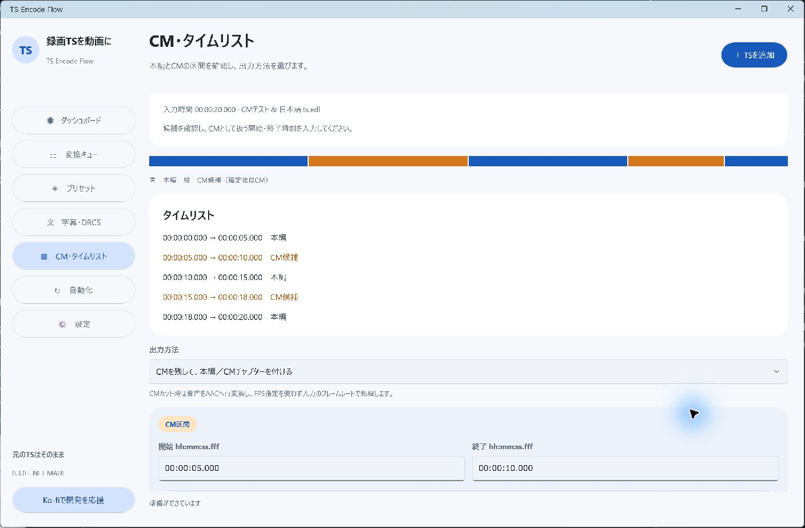

# TS Encode Flow

録画したTSをMP4・MKVに変換するWindows x64アプリです。.NET MAUIのネイティブUIを使い、Pixel / Material風の丸み・余白・明るい配色で構成しています。


現在の版は **v0.5.7** です。開発中のWindows向けアプリです。

- [導入・操作手順](docs/SETUP.md)：初期設定、AMD変換、字幕、EPGTimer連携、再実行
- [ソースからのビルド](docs/BUILD.md)
- [検証記録と未検証事項](docs/VALIDATION.md)

[最新版のダウンロード（Releases）](https://github.com/Long0823-1/TS-Encode-Flow/releases/latest) からWindows x64用ZIPを取得します。「Code → Download ZIP」はソースです。
## はじめ方

1. 配布ZIPをすべて展開し、`TS-Encode-Flow.exe` を起動します。Windows 10 バージョン2004以降／Windows 11 x64に対応します。
2. **設定 → すべてダウンロードして適用**を押します。FFmpeg／ffprobe、NVEncC、VCEEncC、QSVEncC、EDCBの番組情報DLL、CM解析ツールを取得・展開し、パスを自動設定します。個別取得と手動パス指定も可能です。各カードの「ライセンス・配布元を確認」からバージョン・取得元・SHA-256・ライセンス文書を表示できます。
3. **プリセット**で変換方式と用途を選びます。TSを追加すると変換キューに入ります。まとめて追加・ドラッグ＆ドロップ・最大8本の並列処理に対応します。
4. 完了した動画は指定した保存先に作成します。元のTSは削除しません。同じ出力名は連番にして保持します。


## CMカット・CMチャプター・タイムリスト

プリセットの「CM・タイムリスト」で、次の出力方法を選べます。既定はCM処理OFFです。

| 方法 | 動画 | 区間の確認 |
| --- | --- | --- |
| CMを残してチャプター | 録画全体を保持し、本編／CM候補のチャプターを付与 | アプリの一覧、再生ソフトのチャプター、CSV |
| CMをカット | 本編の区間だけをつなぎ、字幕時刻も詰める | 本編チャプターと入力・出力時刻を記録したCSV |

「変換前にCM候補を確認する」は既定ONです。「CM確認待ち」になったら **CM・タイムリスト** を開き、色付きバー・区間一覧を見ながらCMの開始／終了を修正し、出力方法を選んで確定します。CMを残す方式なら、まず候補の位置を確認する用途にも使えます。確定前にCMを削りません。

区間は手動入力、EDL、join_logo_scp系の `Trim(start,end)++Trim(...)` 形式のAVSから読み込めます。AVSのプログラムを実行する機能ではありません。Trimの終端は指定フレームを含み、0は入力終端として扱います。外部ツールと同じ映像・FPS・フレーム基準が必要です。Amatsukazeで前処理やVFR化した別のフレーム列のTrimを、そのまま元TSへ適用しないでください。



**自動解析は、ロゴ検出（logoframe）→無音・シーンチェンジ検出（chapter_exe）→区間判定（join_logo_scp）を直接実行します。** Amatsukazeと共通するCM解析用のツール構成を使いますが、Amatsukazeの本体・GUI・サーバー・エンコード機能は移植・導入しません。Comskip方式は廃止しました。

設定でCM解析ツールとlogoframeを自動取得し、プリセットの取得方法を「Amatsukaze方式でCM候補を自動解析」にします。放送局ロゴは局ID（ネットワーク・TS・サービスID）と元映像の解像度ごとに保存・再利用します。対応するLGDがなく、範囲も未登録の場合だけ「ロゴ範囲指定待ち」で止まります。キューの「ロゴ範囲を指定」、または「放送局ロゴ」を開き、ロゴが映っている本編のプレビューをドラッグして囲み、「この局の範囲を保存して再開」を押してください。指定範囲からLGDを生成し、次回から再利用します。プレビューは指定時刻の1フレームだけを取得し、全編の解析用動画は作りません。対象局のLGDやjoin_logo_scpのスクリプトも手動指定できます。最初からロゴなしで解析する場合は、プリセットの「ロゴを使わない」をONにします。ロゴ生成失敗後だけの切り替えは「ロゴ取得失敗時は無音・シーンチェンジのみで続行」で選択できます。解析失敗を「CMなし」とみなして続行しません。

元TSを直接読み取り、CM解析側のインデックスとFFmpegが読み取った全フレームの時刻を照合します。ツールによって映像・音声のトラック番号が違う場合も、元TS内のパケット位置と時刻で対応を特定します。先頭の不完全なGOPによる番号のずれを補正するための全編再エンコードや解析用動画のコピーは行いません。インデックスは設定フォルダーの `Commercials/IndexCache` に保存して再利用します（検証した約30分・2.3GBのTSで約58MiB。解析中は作業用コピーも使用）。初回は録画フォルダーに `.lwi` を一時生成するため書き込み権限が必要です。元からある同名インデックスは退避・復元します。映像・音声の読み取りと解析時間、インデックス用の空き容量は必要です。通常の一定FPSを対象とし、途中の時刻不連続や形式変更は自動適用を停止します。末尾だけに小さな時刻差がある場合は最後の1秒を自動削除から保護します。判定精度は番組・局・ロゴで変わるので、初回は確認ONを使用してください。

完了した動画の隣に `.cm.csv`・`.cm.json` を保存し、入力のどの区間を残したか確認できます。確認を省略した自動候補はチャプターにも「CM候補」と表示します。元TSは保持します。

CMカット時は音声をAACへ再変換し、任意FPS指定を使わず入力のフレーム基準で処理します。CPUはFFmpegのtrim／concat、GPUはエンコーダーの `--trim` を使います。CPU・AMDの20秒TSでCMカット後12秒になること、音声長・字幕時刻・チャプター・実際のカット位置を確認しました。VFR、途中でフォーマットが変わる録画、NVIDIA／Intelでの実カットは未検証です。CPUカットはFFmpeg 9で確認しており、古いFFmpegでオプションエラーになる場合は更新してください。

先行プロジェクト： [Amatsukaze](https://github.com/nekopanda/Amatsukaze) / [join_logo_scp](https://github.com/nekopanda/join_logo_scp) / [logoframe](https://github.com/tobitti0/logoframe)。本アプリではCM解析の連携と、独自の確認・出力処理を実装しています。

## バックグラウンドとトレイアイコン

アプリ起動時、または録画後BATからの登録時に、ワーカーがWindowsの通知領域に常駐します。画面を閉じても変換・監視は続きます。アイコンのダブルクリックで変換キューを表示し、右クリックから「GUIを開く」「変換キューを開く」「字幕・DRCSを開く」を選べます。既にGUIを開いている場合は、その画面を前面へ戻します。

アイコンにマウスを置くと変換中・待機中・DRCS入力待ち・一時停止の状態を確認できます。DRCS入力待ちになったときはバルーンでも案内します。Windows側の通知設定によってはバルーンが出ないことがあります。

終了する場合は右クリックの「バックグラウンドを終了」を使います。変換中は中止するか確認します。終了後、待機ジョブは「処理を再開」から再開できます。EDCBをサービスとして動かしている場合など、対話デスクトップのないセッションにはトレイアイコンを表示できません。同じ設定フォルダーを指定したGUIからキューを確認してください。

## アプリ内の更新通知

起動時と、画面を開いている間の6時間ごとにGitHubの最新正式リリースを確認します。新しいバージョンがあればメニュー共通のバナーに表示し、「更新内容・ダウンロードを開く」からReleasesへ進めます。**設定 → アプリの更新 → 更新を確認**でも手動確認できます。

自動インストールは行いません。変換が終了してから画面・ワーカーを終了し、新しいZIPをすべて展開して切り替えてください。配置先が変わった場合は録画後BATを作り直します。通信できない場合も通常の変換は利用できます。確認にはGitHubのリリースAPIだけを使用し、録画内容・設定・ログは送信しません。

更新対象は `v0.2.4` 形式の正式版タグを持つ公開Releasesです。ソースのコミットのみの追加、ドラフト、プレリリースは通知対象になりません。v0.2.3以前にはこの機能がないため、最初のv0.2.4への更新は手動で行ってください。

## 48種類のプリセット

12の用途を、CPU・NVEncC・VCEEncC・QSVEncCそれぞれに用意しています。

- 通常番組：バランス、高画質、省容量
- アニメ：輪郭重視、シリーズ保存、24p素材向け
- 映画：ディテール重視、再生互換性重視
- スポーツ：Yadif倍フレームによるなめらかな出力
- モバイル：360p・小容量
- 音声コピー・MKV、AV1対応機器向け

画面上部の **「＋ 自作プリセットを追加」** から新規作成できます。選択中の変換方式を引き継ぎ、保存後は「カスタム」に表示して選択します。

幅・高さ、縦横比の保持、拡大禁止、クロップ、Yadif／Bwdif、フレームレート、ノイズ除去、シャープ化、画質値／VBR／CBR、音声をカスタマイズできます。設定を変更したら自分用のプリセットとして保存します。追加済みジョブは、追加時の設定を保持します。

24pプリセットはフレームの間引き・複製です。逆テレシネの自動判定ではありません。GPU変換でフレームレートを明示した場合は、FFmpegの可逆中間ファイルを使用するため大きな空き容量が必要です。GPUのコーデック・フィルタ対応はハードウェアとドライバーに依存します。未対応時にCPUへ自動変更はしません。

## 録画後の自動実行BAT

**自動化**のカード内で、録画後専用の変換方式・プリセットを選んで「このプリセットで録画後BATを作成」を押します。カスタムプリセットも選べます。手動変換用の選択とは別に保存します。

作成した `.bat` をEPGTimerの録画設定の「録画後実行」に指定してください。同時に作られる `.bat.profile.json` も隣に置きます。BATには作成時のプリセット・保存先・ファイル名マクロを固定します。変更を反映する場合はBATを作り直します。


`_EDCBX_DIRECT_` による環境変数直接実行に対応したEDCB版が必要です。`FilePath` 環境変数で録画ファイルを受け取り、ウィンドウを表示せずワーカーへ渡します。アプリ画面を閉じても変換できます。EDCBをWindowsサービスで利用している場合は、実行ユーザーがアプリ・設定・録画保存先へアクセスできる必要があります。

録画フォルダー監視も利用できます。サイズと更新時刻が指定秒数変化せず、書き込み中でないTSを登録します。確実な録画終了通知にはBAT連携を推奨します。Windowsの動作と、エンコーダーの利用可能なGPUセッションが必要です。

## ファイル名マクロと番組情報

例：`{Start:yyyyMMdd_HHmm}_{Channel}_{Title}`

| マクロ | 内容 |
| --- | --- |
| `{Title}` | 番組名。取得できない場合は元ファイル名 |
| `{Channel}` | 放送局名 |
| `{Start:yyyyMMdd_HHmm}` | 番組開始日時。取得できない場合はファイル更新日時 |
| `{Episode}` | 番組名に含まれる「第12話」「#12」などの数字 |
| `{OriginalName}` | 元のTSファイル名（拡張子なし） |
| `{ServiceId}` / `{EventId}` | サービスID／イベントID |
| `{NetworkId}` / `{TransportId}` | ONID／TSID |
| `{Width}` / `{Height}` | 入力映像の幅／高さ |
| `{Codec}` / `{Engine}` | 出力コーデック／変換方式 |

相対サブフォルダーも指定できます。ファイル名に使用できない文字は置き換えます。出力パスが長い場合はマクロを短くしてください。

日本語のTS内EIT・SDT解析には、EDCB x64の `EpgDataCap3.dll` を指定します。EDCBの `.ts.program.txt` または `.program.txt` があれば、録画日時・局名・番組名はその内容を優先します。情報のないTSでは正しい番組名や放送日時を復元できないため、代替情報を使用します。

「番組情報をメタデータに保存」を有効にすると、取得した番組名・局名・日時・説明・話数・SID・イベントIDを動画へ格納します。表示される項目は再生ソフトにより異なります。解析結果と設定は `.encode.json` にも保存します。

## 字幕とDRCSの手動補正

「字幕を動画内に保存」は既定で有効です。選択サービスの最初の字幕トラックをテキスト化し、MP4にはmov_text、MKVにはASSとして格納します。字幕の表示・非表示は再生ソフト側で切り替えます。字幕文のない区間では字幕トラックを作成しません。

ARIB字幕は同梱のlibaribcaptionベースの解析ツールで処理します。字幕の配置・配色・ルビ・DRCSの画像表示を放送どおりに完全再現する方式ではありません。テキストとして読める字幕を保存します。

既定では、未対応のDRCSが見つかった場合にジョブを**DRCS入力待ち**にします。

1. **字幕・DRCS**を開いて、字形画像と字幕の前後を確認します。
2. 必要なら「写真・スクリーンショットを選ぶ」で参考画像を並べます。
3. 代替文字を入力し「保存して待機中の変換を再開」を押します。
4. 同じ字形は次の録画でも保存済み対応表を使います。すべての未対応文字を登録すると待機ジョブを再開します。

### 字幕エラーを無視する選択

プリセットの新規作成・「詳細・カスタマイズ」の音声・字幕欄で、**「字幕エラーを無視して続行」** を選べます。既定はOFFです。

- OFF：未対応DRCSは補正待ち、字幕解析や格納の失敗はエラーとして停止します。
- ON：未対応DRCSは `�` に置き換えます。字幕の抽出・格納に失敗した場合は字幕なしで映像・音声の変換を続け、警告を完了表示・ログ・`.encode.json` に残します。

既に止まっているジョブには、変換キューの **「字幕の問題を無視して再試行」** を使えます。この操作はそのジョブだけに適用され、保存済みプリセットを変更しません。映像・音声の変換エラーや中止操作は無視しません。録画後BATにこの方針を適用する場合は、変更したプリセットを選んでBATを作り直します。

字形定義がTSに含まれているDRCSが対象です。OCRで自動認識せず、人が確認して入力します。対応表は `%LOCALAPPDATA%/TS-Encode-Flow/Drcs/replacements.json` に保存します。写真はアプリのローカル設定領域へコピーし、外部へ送信しません。


画面のDRCSは字幕デコーダーの検証用サンプルです。

## ツールと構成

配布ZIPには.NET・MAUI・Windows App SDKの実行に必要なファイルと、字幕解析ツールを含めます。FFmpeg・Rigaya製エンコーダー・EDCB DLLは同梱しません。各公式配布物を使用してください。ZIP内のWorker・Tools・DLL類を取り除いたり、設定済みBATが指すアプリの保存場所を変更しないでください。

- `src/App`：MAUI / WinUIの画面
- `src/Core`：プリセット、メタデータ、DRCS、変換、キュー
- `src/Worker`：BAT・フォルダー監視のバックグラウンド実行と通知領域のアイコン
- `native`：libaribcaptionを使ったARIB字幕・DRCS画像抽出

ビルドには.NET 9 SDK、MAUI Windowsワークロード、Visual Studio 2022のC++／CMake／Windows SDKが必要です。

```powershell
./scripts/publish.ps1
dotnet run --project tests/Tests.csproj -c Release
```

字幕ライブラリは `37dde0f32652c32aa98bf92278944d1cfb2e7354` に固定しています。

## 検証と制限

Windows x64上で、CPUとAMD Radeon RX 570 / VCEEncCによる並列変換、解像度変更、Yadif倍フレーム、字幕とメタデータのMP4／MKV格納、DRCS画像抽出・文字対応表の保存・字幕への適用、生成BATの実行を確認しています。実際の放送TSでも字幕とEIT番組名のMP4保存を確認しました。

NVIDIA／Intel GPUの実変換は未検証です。AV1・HEVCなどの全プリセットを全GPUで検証したわけではありません。EPGTimerの実録画終了からの起動は、ご利用のEDCB版・ユーザー権限で確認してください。暗号化されたTSの復号や、PCの電源復帰は行いません。

[Ko-fiで開発を支援](https://ko-fi.com/long0823) · [第三者ソフトのライセンス](THIRD-PARTY-NOTICES.md)

## ツールの自動準備とライセンス

一括取得は約800MB（配布版によって変動）で、展開時にも空き容量が必要です。ツールは設定フォルダー内の `Tools` に置き、管理者権限やシステムへのインストールを必要としません。ダウンロード中止・個別の再試行に対応し、成功したものから設定へ適用します。既存の手動指定パスも、一括適用を押すと取得した版へ置き換えます。GPUドライバーは別途必要です。

CMの依存ツールは公式の配布アーカイブから必要ファイルと文書だけを展開し、AmatsukazeCLI・GUI・サーバー・各種エンコーダー等は配置しません。logoframeは独立したGPL-3.0プログラムとして配布し、完全な対応ソースをツールZIPと `third_party/CmLogo` に含めています。外部ソフトのライセンスは各々に適用されます。[第三者ライセンス](THIRD-PARTY-NOTICES.md)も参照してください。

## 変換履歴をクリア

**変換キュー → 履歴をクリア**で完了・失敗・キャンセル・中断の履歴を消せます。待機・処理中・ロゴ範囲／字幕／CMの確認待ちは残し、元TS・出力動画・ログは削除しません。監視フォルダーの同じ録画を自動で再登録しないための識別情報は保持します。TSを手動で追加して再変換することは可能です。

TSを手動追加・録画後BATから追加すると、ワーカーを起動し、一時停止中でも自動再開します。再試行やCM区間の確定でも自動再開します。「処理を再開」を押す必要はありません。既に最終更新から安定待ち時間（既定60秒）以上経ち、書き込み中でないTSは、追加後の次の処理周期で解析を始めます。録画中・更新直後・途中で変更を検出したTSは安定確認を待ちます。並列数の上限やCM・DRCSの確認待ちも維持します。監視フォルダーからの自動検出だけでは、明示した一時停止を解除しません。

カスタムプリセットのカードにある「このカスタムプリセットを削除」で、確認後に削除できます。標準プリセットは削除できません。選択中のプリセットを削除すると同じ変換方式の標準へ戻り、録画後BAT用の指定も補正します。登録済みジョブ・作成済みBATは作成時の設定を保持します。

カスタムプリセットは同名なら上書き保存します（名前の前後の空白と英字の大小は区別しません）。変換方式を変えても同じ名前は1件にまとめ、標準プリセットは保護します。カスタムの編集では名前を維持するため、そのまま保存して更新できます。

中止済みジョブの「プリセットを変更」から個別に設定を選び、「このジョブに適用」→「再試行」で再開できます。適用がワーカーに反映されてから選択画面を閉じます。CM解析・字幕の確認状態はリセットし、保存先とファイル名マクロは維持します。実行中のジョブは中止が完了してから変更してください。


## ロゴ取得失敗時の切り替えを事前に選ぶ

プリセット編集の「CM・タイムリスト」に、チェックボックス **「ロゴ取得失敗時は無音・シーンチェンジのみで続行」** を追加しました。既定はOFFです。

変換前にONにして保存すると、自動ロゴ取得・検出に失敗した場合だけロゴを使わない解析へ切り替え、chapter_exeとjoin_logo_scpでCM候補を判定します。ロゴが取れた場合は通常どおり使用します。「ロゴを使わない」は最初からロゴを使用しない別の設定です。

CM処理を有効にし、自動解析を選択すると設定できます。切り替えはログとCM解析結果の情報元へ記録し、CM候補の確認設定は維持します。手動LGD指定の失敗・入力検証の失敗・中止を無視する設定ではありません。

登録済みジョブ・作成済み録画後BATは作成時の設定を保持します。新しいプリセットでTSを追加し直すか、中止済みジョブのプリセットを変更してください。録画後BATへ反映する場合は、保存したプリセットでBATを作り直します。


### 放送局ロゴの初回設定

- 「放送局ロゴ」で局・元解像度・登録済みLGD・指定範囲を確認できます。局IDが特定できる既存バージョンの局別LGDもそのまま再利用します。局ID不足時は局名、局名もない場合は入力パスで分離し、他局との取り違えを避けます。
- 未登録局だけ、ロゴが映る秒数を選んでプレビューを表示し、ロゴ全体と少しの余白を囲みます。1440×1080など横長ピクセルの映像も、表示の縦横比と元座標を対応させて保存します。X・Y・幅・高さの直接入力もできます。出力用クロップ・リサイズ前の範囲です。
- 録画後BATでも未登録局は待機し、タスクトレイからGUIを開けます。範囲の確定で同じ局・解像度の待機ジョブを自動再開します。範囲・LGDは設定フォルダーの `Logos` に保存します。
- ロゴ生成失敗時のフォールバック設定は、初回の範囲指定を省略する設定ではありません。指定範囲から生成・検出を試みた後の失敗に適用します。ロゴが映っていない番組や局側のデザイン変更では、範囲指定だけで取得成功を保証できません。


## ロゴを囲んでも「有効画素が少ない」となる場合（v0.5.5）

範囲指定はロゴの位置を伝える設定です。薄いロゴや、周囲に番組テロップが重なる場面では、従来の単色背景の判定が本編を除外し、ロゴのない場面ばかりから生成を試みて失敗する場合があります。

v0.5.5では、通常の生成に失敗した場合だけ、境界画素の70%以上が狭い輝度範囲に集まる背景から再推定します。複雑な背景を無条件に単色扱いする方式ではありません。通常の生成が成功した場合は従来の経路を維持します。

再推定した候補は **「生成ロゴ確認待ち」** になります。「放送局ロゴ」またはキューの **「生成ロゴを確認」** を開きます。番組名や大きなテロップが見えたら **「登録せず範囲を選び直す」** を選び、局ロゴの見えている文字部分などに範囲を絞ってください。局ロゴだけなら **「局ロゴとして保存して再開」** で同じ局の待機ジョブを再開します。確認前の候補は局別LGDとして再利用しません。

改善したlogoframeとGPL-3.0のライセンス・完全な対応ソースを `Tools/CmLogo` と `Worker/Tools/CmLogo` に同梱しています。アプリ管理のロゴツールを使用している場合は同梱版を優先します。手動で別の実行ファイルを指定している場合は、設定から更新版logoframeを取得して適用してください。CM解析用のAviSynth・chapter_exe等は従来どおり設定から取得します。

更新時はGUIだけでなく、タスクトレイのTS Encode Flowも「バックグラウンドを終了」で閉じてから新しい版を起動してください。変換中なら完了を待ってください。旧ワーカーが常駐したままでは新しい生成処理に切り替わりません。

CM処理OFF・最初からロゴなしの設定では候補生成・確認を求めません。生成自体が失敗する場合の無音／シーンチェンジへの切替設定も引き続き使用できます。ロゴ候補の確認待ちを、生成失敗として自動で無視することはありません。


## ロゴを一覧で確認・削除・手動追加する（v0.5.6）

**「放送局ロゴ」** に登録済みのロゴと未承認の生成候補を画像で表示します。放送局・元解像度・ファイル名・位置・ロゴのサイズ・「使用中／保管中」を確認でき、**「画像を拡大」** で大きく表示できます。市松模様は透過確認用で、画像は輝度と透過率の表示です。一覧は表示付近のカードを生成する方式です。

### 手動追加

1. **「LGDを手動追加」** または各カードの **「この局に手動追加」** を開きます。
2. 登録先の放送局と元映像の解像度を選びます。新しい放送局の場合は局名・ONID・TSID・SID・元の幅／高さを指定できます。LGD自体には元映像全体の解像度が含まれないため、録画と同じ解像度を選んでください。
3. LGD／LGD2ファイルを1件選び、表示されたロゴと位置を確認して **「この局のロゴとして追加して再開」** を押します。v0.1／v0.2形式・1ロゴ入りのファイルに対応します。PNG／JPEGの画像だけを追加する機能ではありません。

元のファイルを保持したまま設定フォルダーへコピーし、新しい版を「使用中」にします。以前の版も残します。同じ局のロゴ範囲・画像確認待ちジョブは、このロゴで再開します。保存済みの登録は、キュー履歴をクリアしても残ります。

### 削除

登録済みロゴの **「この版を削除」** を押し、確認画面で削除します。古い版の削除では使用中の版を維持します。使用中の版を削除すると、残っている最新の版へ切り替わります。最後の版を削除すると未登録になります。保存した放送局情報・範囲は保持します。

未承認の生成画像は **「候補を削除」** でファイルを削除し、範囲指定待ちへ戻せます。この操作で局ロゴへ登録されることはありません。削除しても元TSや外部から追加した元ファイルは削除しません。

対象局のジョブを処理中、または生成処理がロゴフォルダーを使用中の場合は追加・削除を受け付けません。完了または中止後に操作してください。GUIで表示後にファイルが変更された場合も、一覧を更新してから操作する必要があります。

設定の「対象放送局のロゴLGD」に固定ファイルを指定している場合は、それが局別ライブラリより優先されます。局別管理を使う場合は固定指定を空欄にしてください。


## v0.5.7：逆テレシネの自動判定

プリセットの「画質とフィルタ」で「逆テレシネを自動判定（3:2 → 23.976fps）」にチェックして保存してください。既存プリセット・BATの動作は自動変更しません。録画後BATへ適用する場合は、その設定でBATを作り直してください。

- 29.97fpsの入力だけを対象に、最大5か所×8秒を元解像度で解析します。CMカット時は残す本編区間から選びます。3か所未満の短い映像は判定しません。
- `idet`のフィールド繰り返しを調べ、5フレーム中「上1・下1・繰り返しなし3」の一致率90%以上が全サンプルで揃った場合だけ適用します。
- 復元はFFmpegの `fieldmatch → bwdif（残留縞のみ）→ decimate`。出力23.976fpsを検証します。不明・混在の場合はプリセットの通常のインターレース解除を使います。
- GPUを選んでも判定・逆テレシネはCPUで行い、FFV1の可逆中間MKVを作ってからGPUへ渡します。高速なSSDと十分な空き容量が必要です。CMカット併用時は映像・音声を時間で切り出してから復元し、入力FPSによる二重カットを避けます。
- 手動FPS指定や追加引数による競合フィルタは併用できません。判定理由はジョブ詳細・ログ、サンプルごとの一致率はログと `.encode.json` に保存します。
- 抽出区間による保守的な判定であり、全編の24/30/60fps混在やVFRの自動復元ではありません。サンプル外の混在を完全には検出できず、静止画の多いアニメは安全側で判定しないことがあります。

処理方式の参考：[FFmpeg公式フィルタ仕様](https://ffmpeg.org/ffmpeg-filters.html#fieldmatch)。
