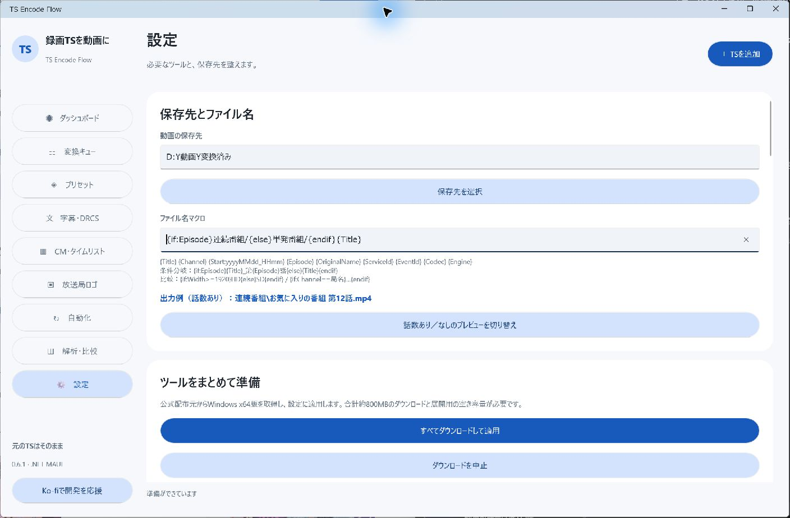
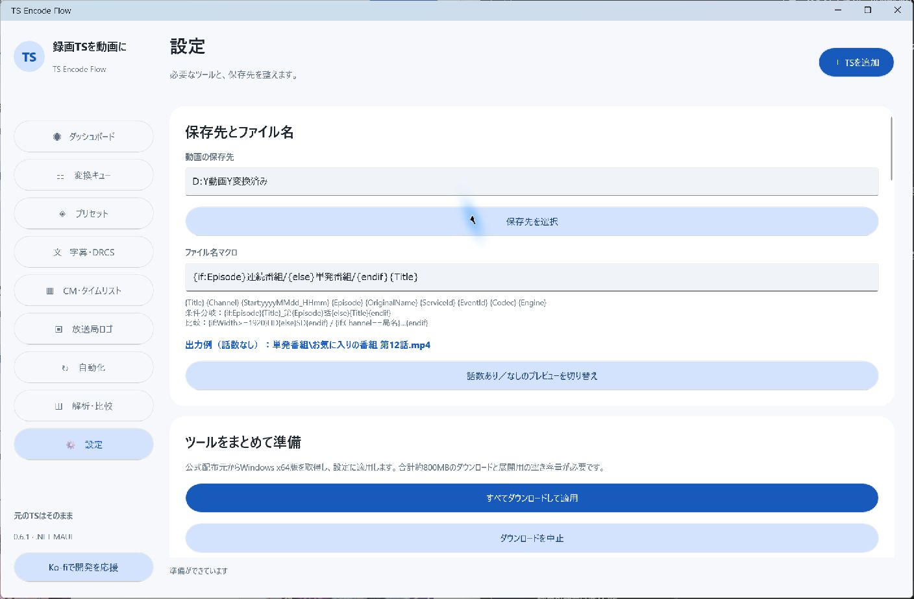

# ファイル名マクロと条件分岐

「設定 → ファイル名マクロ」で指定します。設定画面の出力例では「話数あり／なし」を切り替えられます。拡張子はMP4／MKVの設定から自動付加します。

## 通常の項目

`{Title}`、`{OriginalName}`、`{Channel}`、`{Episode}`、`{Start:yyyyMMdd_HHmm}`、`{Width}`、`{Height}`、`{ServiceId}`、`{EventId}`、`{NetworkId}`、`{TransportId}`、`{Codec}`、`{Engine}`。

幅・高さは入力映像の情報です。Engineは`CPU`／`NVEncC`／`VCEEncC`／`QSVEncC`、Codecは`H264`／`HEVC`／`AV1`です。Startの書式は.NETの日時書式を使います。パス区切りを日時書式に入れた場合はファイル名として安全な文字に置き換えます。

## if・else・endif

```text
{if:Episode}{Title}_第{Episode}話{else}{Title}{endif}
```

話数が入っていれば`番組_第12話.mp4`、空なら`番組.mp4`になります。`else`は省略できます。`{if:!Episode}`は話数が空の場合です。0という話数文字列も「入っている」と扱います。

Titleに既に話数が含まれていても、自動では取り除きません。話数の重複を避けたい場合は、次のようにフォルダーだけ分けられます。

```text
{if:Episode}連続番組/{else}単発番組/{endif}{Title}
```





v0.6.1の設定画面です。プレビューは架空の固定番組情報で、ボタンはEpisodeの有無だけを切り替えます。Title自体の「第12話」は変わりません。実際の録画でも、話数を取得できなかった連続番組は空の分岐に入るため、「単発番組」という分類が正しいと保証するものではありません。

### 文字列を比較する

```text
{if:Channel=="TOKYO MX1"}MX/{else}その他/{endif}{Title}
```

`==`／`!=`で比較できます。項目名と英字の比較は大文字・小文字を区別しません。比較値の外側の空白は取り除きます。値は一重または二重引用符で囲めます。引用符内の空白は残します。

### 数値を比較する

```text
{if:Width>=1920}フルHD/{else}その他/{endif}{Start:yyyyMMdd}_{Title}
```

`>`／`>=`／`<`／`<=`はWidth・Height・Episodeと各IDで使用できます。話数がない場合の大小比較はfalseです。

### 入れ子

```text
{if:Episode}{if:Width>=1920}HD/{else}SD/{endif}{Title}_第{Episode}話{else}特番/{Title}{endif}
```

入れ子は8段、テンプレートは4096文字までです。AND／OR／elseif、任意のスクリプト実行には対応していません。分岐内の通常マクロは選ばれた側だけを出力します。

`if`と`endif`の対応、重複した`else`、未知の項目、数値の誤りはエラーにします。分岐を使っても絶対パスや`..`で保存先の外へ出すことはできません。Windowsで使えない文字の置換と、既存出力への連番も適用します。

## 適用されるタイミング

登録済みジョブは追加時のマクロを保持します。変更後は新しく追加するジョブに反映します。録画後BATも作成時のマクロを保持するため、変更した設定を自動変換に使う場合はBATを作り直してください。
