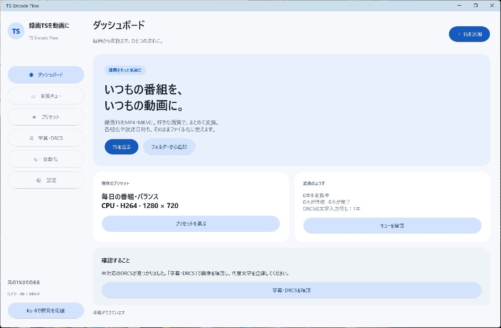
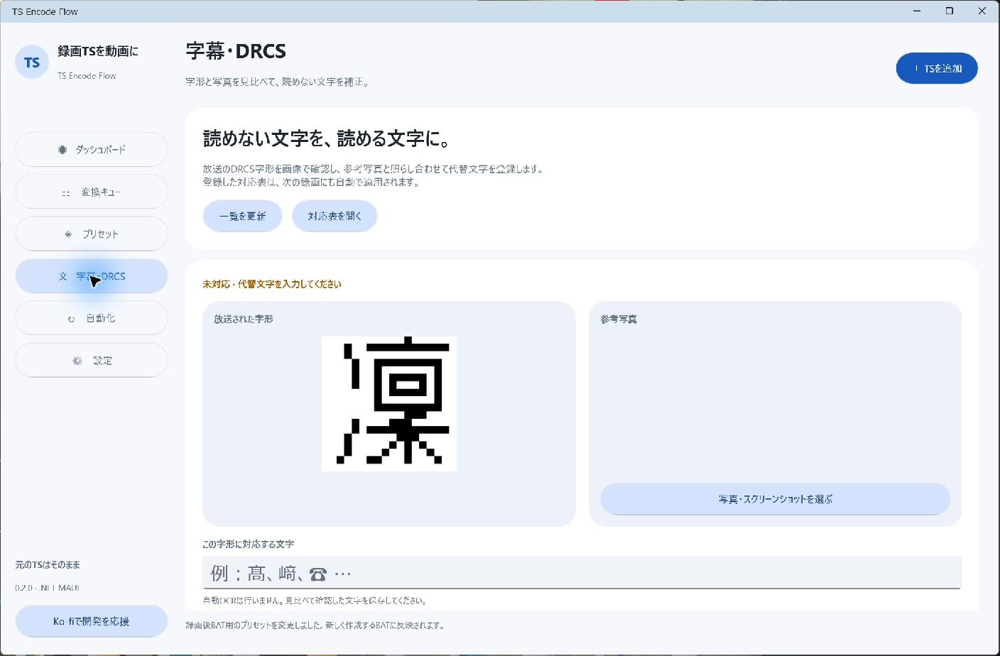
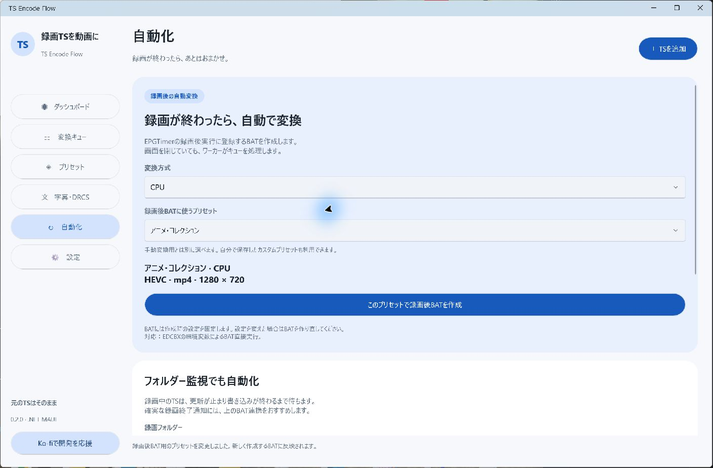

# 導入・操作手順（v0.2.3）

## 1. アプリを配置する

Windows 10 バージョン2004以降／Windows 11 x64を使用します。ビルド済み配布ZIPをすべて、今後移動しないフォルダーに展開し、`TS-Encode-Flow.exe` を起動します。ZIP内から直接実行しないでください。`Worker`、`Tools`、DLLも必要です。.NET・MAUIの実行ファイルは配布物に含まれます。

GitHubの「Code → Download ZIP」はソースです。ビルド済みZIPが手元にない場合は[ビルド手順](BUILD.md)から作成します。

## 2. 変換ツールと保存先を設定する

**設定**を開き、次を指定して「設定を保存」を押します。

| 項目 | 指定するファイル |
| --- | --- |
| FFmpeg（すべての方式で必須） | `ffmpeg.exe` |
| ffprobe（すべての方式で必須） | `ffprobe.exe` |
| AMDを使う場合 | `VCEEncC64.exe` |
| NVIDIAを使う場合 | `NVEncC64.exe` |
| Intelを使う場合 | `QSVEncC64.exe` |
| TS内の日本語番組情報を解析する場合（任意） | EDCB x64の `EpgDataCap3.dll` |

画面内の各ツールの配布元リンクから入手できます。CPUはFFmpegを使います。GPU方式にもFFmpegとffprobeが必要です。GPUドライバーと、そのGPUが対応するコーデックを使用してください。

「動画の保存先」と「ファイル名マクロ」も設定します。例：`{Start:yyyyMMdd_HHmm}_{Channel}_{Title}`。元TSと同じ名前になる場合を含め、既存の出力は連番で保持します。

## 3. AMDで変換する

1. **プリセット**を開き、「変換方式」でAMD / VCEEncCを選びます。
2. 最初は「毎日の番組・バランス」を選択します。解像度は1280×720、H.264のプリセットです。
3. 用途に合わせてアニメ・映画などへ変更できます。「詳細・カスタマイズ」で解像度、画質、Yadif／Bwdif、音声、字幕などを調整し、自分用のプリセットとして保存できます。
4. **＋ TSを追加**から録画済みTSを選びます。複数選択、フォルダー追加、ドラッグ＆ドロップにも対応します。
5. **変換キュー**で進捗を確認します。録画中のTSは書き込み終了まで待機します。完了後の「出力先」で保存場所を開けます。

追加済みジョブは追加時のプリセットを保持します。プリセットを変更しても既存ジョブには反映されません。変更した設定を使いたい場合は対象を中止し、TSを選び直して追加します。

## 自作プリセットを新規追加する

1. **プリセット**画面の上部で変換方式を選びます。
2. **「＋ 自作プリセットを追加」** を押します。
3. 名前、コーデック、解像度、画質、フィルタ、音声・字幕などを設定します。
4. 画面下部の **「自作プリセットを追加」** で保存します。

保存後は「カスタム」に表示され、そのプリセットが選択されます。編集画面で変換方式を変更して保存した場合も、保存した方式の一覧へ切り替わります。既存設定をベースにする場合は、従来の「詳細・カスタマイズ」を使用できます。

## 4. 中止したTSを再実行する

- 同じ設定でやり直す場合：キューの「再試行」を押します。
- 現在選んでいるプリセットでやり直す場合：中止が完了した後、同じTSを再選択します。
- v0.2.2ではキャンセル済み・完了済みの履歴があっても手動で新規追加できます。待機中・変換中の同じTSは重複追加されません。
- フォルダー監視は履歴を使って繰り返し投入を防ぎます。監視対象を意図的に再実行するときも、手動追加か「再試行」を使います。

元TSと過去のキュー履歴は保持します。

## 5. 字幕・番組情報・DRCSを保存する

字幕保存と番組情報メタデータ保存をプリセットで有効にします。MP4はmov_text、MKVはASSの切り替え可能な字幕として保存します。放送時の配置・色などを完全再現する方式ではありません。

TSの隣にEDCBの `.ts.program.txt` または `.program.txt` がある場合は、一緒に残してください。番組名・日時・局名に利用します。字幕PIDの宣言だけがあり実データがない録画は、字幕を作らず正常完了します。

未対応のDRCSで止まった場合：

1. **字幕・DRCS**で字形と前後の字幕文を確認します。
2. 必要なら参考の写真・スクリーンショットを選びます。
3. 代替文字を入力して「保存して待機中の変換を再開」を押します。

対応表は保存され、次の録画にも利用されます。自動OCRではなく手動で照合・入力する機能です。

## 6. EPGTimerの録画後に自動変換する

1. 手動で短いTSの変換を確認します。
2. **自動化**で録画後専用の変換方式とプリセットを選択します。手動変換の選択とは独立しています。
3. 「このプリセットで録画後BATを作成」を押し、保存します。
4. 生成された `.bat` と `.bat.profile.json` を同じフォルダーに置きます。
5. EPGTimerの対象の録画設定で「録画後実行」に生成BATを指定します。予約・プリセットごとの設定への反映方法はEDCB版によって異なります。
6. まず1件の録画で、録画終了後にキューへ追加され、出力が作成されることを確認します。

`_EDCBX_DIRECT_` に対応し、録画TSのパスを `FilePath` 環境変数で渡せるEDCB版が必要です。BATはウィンドウを出さずワーカーへ登録します。アプリの画面を閉じても処理しますが、PC自体のスリープ中・電源断中には変換できません。

BATには作成時のプリセット・保存先・マクロを固定します。変更するときはBATを作り直します。アプリを移動したときも作り直してください。EDCBをサービスとして動かす場合は、その実行ユーザーがアプリ・設定・録画先・出力先・GPUにアクセスできる必要があります。

## 7. フォルダー監視と並列処理

**自動化**で監視先、待機秒数、並列数を設定します。録画保存先とは別の出力フォルダーを指定します。TSのサイズ・更新時刻が待機秒数だけ変化せず、書き込み中でもないことを確認して追加します。ネットワーク録画先などでは、録画終了BATによる通知から確認することを推奨します。

並列数はまず1から始め、GPU・CPU・ディスクの余裕を見て増やします。最大8本ですが、GPUの同時セッション数や空き容量による制限があります。

## 8. 更新とトラブル時

新しい配布ZIPは別フォルダーに全展開し、変換中の処理が終わってから旧アプリ・旧ワーカーを終了して切り替えます。旧版と新版を同時に常用しないでください。配置先が変わったらBATも作り直します。

通常の設定・キュー・ログは `%LOCALAPPDATA%\TS-Encode-Flow` にあります。**設定 → 設定フォルダーを開く**でも確認できます。`--data` で起動した場合は指定先に保存します。バックアップはワーカーも停止した状態で行います。

| 症状 | 確認すること |
| --- | --- |
| ツールが見つからない | FFmpeg・ffprobe・選択したエンコーダーの実ファイルへのパスを保存したか |
| メニュー切り替えでコンポーネントのエラー | v0.2.1以降へ更新。改善しない場合は `ui-errors.log` を確認 |
| 中止したファイルを追加できない | v0.2.2以降へ更新。旧ワーカーが残っていないか確認 |
| 追加したのに開始しない | 「処理を再開」、録画の書き込み状態、DRCS入力待ちを確認 |
| GPU変換で失敗する | GPUの対応コーデック・ドライバー・選択ツールを確認。キューの「詳細」でログを見る |
| 字幕がない | 実際に字幕データがあるか、字幕保存が有効か、再生ソフトの字幕選択を確認 |
| BATから追加されない | EDCBX直接実行の対応、`FilePath`、profile.jsonの同居、実行ユーザーのアクセス権を確認 |

検証範囲は[検証記録](VALIDATION.md)に記載しています。NVIDIA／Intelの実機変換、すべてのプリセットの組み合わせ、実際の録画終了イベントは未検証です。

[Ko-fiで開発を支援](https://ko-fi.com/long0823)
